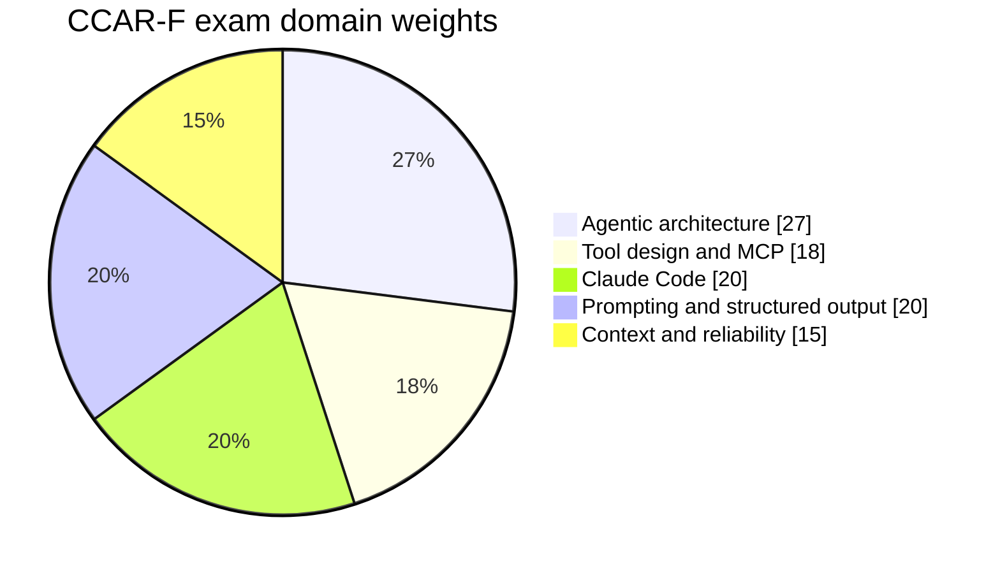
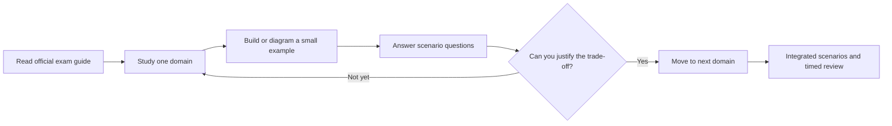
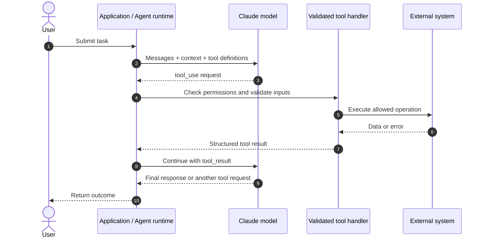
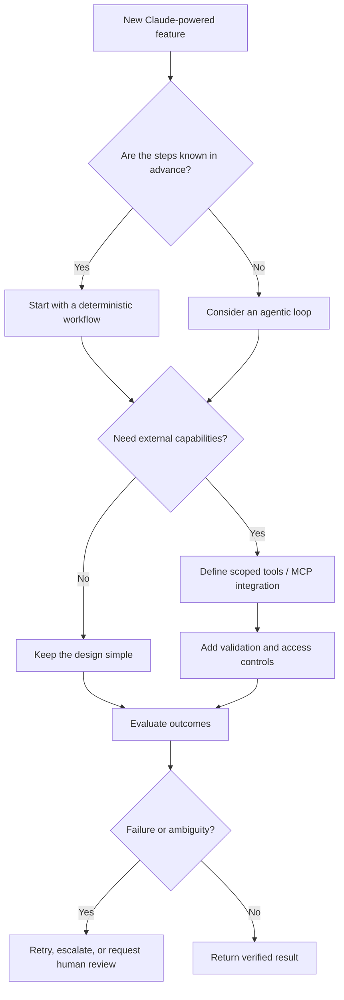

# Claude Certified Architect — Foundations Study Guide and Practice Questions

**Free, open study notes for architects and engineers preparing for Anthropic's Claude Certified Architect — Foundations certification.** The focus is not just remembering terminology: it is **making sound architecture decisions** across Claude Code, the Claude Agent SDK, the Claude API, tool use, MCP, and production reliability.

I created these notes while preparing for the exam, which I subsequently passed, and am sharing them so others can learn, challenge, improve, and contribute.

> [!IMPORTANT]
> **Independent community resource.** This repository is **not** an official Anthropic course, exam bank, or endorsement. Exam policies and product behavior can change. Use the [official certification page](https://anthropic-partners.skilljar.com/claude-certified-architect-foundations-certification) and its exam guide as the source of truth.

**[Start studying](certifcation-domains/)** · **[Exam blueprint](#exam-domains-and-weightings)** · **[Study roadmap](#suggested-study-roadmap)** · **[Architecture diagrams](#architecture-concepts-at-a-glance)** · **[Contribute](#contributing)**

---

## Who is this for?

- **Solution architects** designing Claude-based applications and agentic workflows.
- **AI / ML engineers** integrating Claude with tools, data, APIs, and enterprise systems.
- **Developers and technical leads** using Claude Code or the Claude Agent SDK.
- **Certification candidates** who want to practice *why* one design is more appropriate than another.

The materials are especially useful if you already know the basics of LLMs and want to improve your architectural judgment: **when to use an agent, when to use a simpler workflow, where to enforce constraints, and how to design for failure.**

## Start here

| Step | What to do | Where to go |
|---|---|---|
| 1 | Read the official scope and sample questions | [Anthropic certification page](https://anthropic-partners.skilljar.com/claude-certified-architect-foundations-certification) |
| 2 | Work through the repository's domain materials | **[Browse the study notes](certifcation-domains/)** |
| 3 | Re-create the patterns in small experiments | [Claude Agent SDK docs](https://code.claude.com/docs/en/agent-sdk/overview) · [Claude Code docs](https://code.claude.com/docs/en/overview) |
| 4 | Test your decisions with scenario-based practice | [Browse the study materials](certifcation-domains/) |
| 5 | Revisit weak domains, then run a timed practice session | [Study roadmap](#suggested-study-roadmap) |

**Repository structure (currently):**

```text
claude-certified-architect-foundations/
├── README.md                 # You are here
├── LICENSE                   # MIT license
└── certifcation-domains/     # Domain-oriented study materials
```

---

## Exam at a glance

| Item | Details |
|---|---|
| **Credential** | Claude Certified Architect — Foundations |
| **Exam code** | `CCAR-F` |
| **Format** | 60 scenario-based, multiple-choice and multiple-response items |
| **Time limit** | 120 minutes |
| **Passing score** | 720 / 1,000 (scaled score) |
| **Scenarios** | 4 scenarios selected from 6 described in the exam guide |
| **Delivery** | Pearson VUE: online proctored or test center |
| **Exam fee** | US$125 before any applicable discounts |
| **Validity** | 12 months |
| **Registration** | Via the Anthropic Partner Academy; check current partner eligibility |

*These details reflect the published CCAR-F Exam Guide v1.0 (effective July 2026). Confirm the current price, availability, exam guide, and policies before registering.*

## Exam domains and weightings

| Domain | Weight | What to be able to reason about |
|---|---:|---|
| **1. Agentic Architecture & Orchestration** | **27%** | Tool-use lifecycle, task decomposition, coordinators and subagents, hooks, handoffs, sequential vs. parallel execution |
| **2. Tool Design & MCP Integration** | **18%** | Tool contracts, actionable descriptions, structured errors, authorization boundaries, MCP integrations |
| **3. Claude Code Configuration & Workflows** | **20%** | Project instructions, configuration scope, skills, permissions, repeatable development workflows, CI/CD |
| **4. Prompt Engineering & Structured Output** | **20%** | Explicit constraints, examples, schemas, extraction, validation, structured outputs, retry strategies |
| **5. Context Management & Reliability** | **15%** | Context preservation, failure recovery, escalation, provenance, human review, dependable operation |



**Study implication:** Domain 1 carries the largest share, but the exam tests *cross-domain design decisions*. For example, an agent may need an MCP integration (Domain 2), controlled via a hook or project configuration (Domain 3), with validated JSON output (Domain 4) and recovery from a failed tool call (Domain 5).

---

## Suggested study roadmap

This is an **illustrative two-week plan**, not an official course schedule. Adapt the depth to your hands-on experience.

| Days | Focus | Practical outcome |
|---|---|---|
| **1–3** | Agentic architecture and orchestration | Diagram an agent loop; decide when to delegate to a subagent |
| **4–5** | Tool design and MCP | Design one well-scoped tool with a clear schema and error contract |
| **6–7** | Claude Code workflows | Set up project instructions, permissions, and a repeatable development task |
| **8–9** | Prompting and structured output | Build a schema-driven extraction flow with validation and retries |
| **10–11** | Context and reliability | Handle partial results, timeouts, escalation, and human approval |
| **12–13** | Integrated architecture cases | Compare two plausible designs and justify the trade-offs |
| **14** | Timed review and remediation | Work under exam-like time constraints; revisit weak domains |



### A useful way to answer scenario questions

1. **Identify the actual failure or requirement.** Is it permissions, context, correctness, cost, latency, or orchestration?
2. **Separate deterministic controls from model instructions.** A prompt is not a hard security or schema enforcement boundary.
3. **Prefer the smallest sufficient architecture.** Avoid extra agents, tools, or infrastructure without a justified need.
4. **Check boundaries and handoffs.** What information can a tool or subagent access, and what must it return?
5. **Choose for recoverability.** Consider how failures surface, how retries work, and when a human should intervene.

---

## Architecture concepts at a glance

### 1. The tool-use lifecycle

The important mental model is that **Claude requests a tool operation; the application/runtime executes it**. Tools are not automatically a secure or infallible execution environment. Authorization, validation, error handling, and observability remain application responsibilities.



### 2. Choosing the right architecture



> The diagrams are simplified conceptual references, not prescriptions for every SDK or deployment. A production architecture should follow the relevant current documentation and its specific security model.

### Decision patterns worth practicing

| Scenario signal | Pattern to consider | Common mistake |
|---|---|---|
| A control **must** be enforced | Code, schema validation, permissions, or a deterministic hook | Relying only on a system prompt |
| Independent subtasks can be delegated | Isolated subagents or bounded parallelism | Unnecessary shared context or uncontrolled fan-out |
| An external service needs to be called | A narrowly scoped tool or MCP server | Vague tool descriptions or overly broad privileges |
| Output must satisfy an exact structure | Schema-constrained output and downstream validation | Assuming a plausible-looking JSON string is valid |
| A tool fails or returns partial data | Explicit error propagation and recovery/escalation | Hiding the failure or inventing a successful result |
| Context grows or becomes stale | Summaries, focused retrieval, or isolated sessions | Blindly carrying every prior message forward |

---

## Practical preparation checklist

Use this as a self-assessment rather than a prediction of exam performance.

- [ ] I can explain the **tool request → execution → tool result** cycle.
- [ ] I can distinguish **sequential workflows, agents, and multi-agent systems**.
- [ ] I can choose between **prompt guidance and deterministic enforcement**.
- [ ] I understand what **MCP** provides and where tool security belongs.
- [ ] I can describe the roles of **Claude Code instructions, skills, and permissions**.
- [ ] I can design and validate **structured outputs**.
- [ ] I can handle **timeouts, malformed tool results, and partial failures**.
- [ ] I know when to use **human-in-the-loop review**.
- [ ] I can defend an architecture choice against **cost, complexity, latency, and reliability** constraints.
- [ ] I have read the **official exam guide**, including its scenario descriptions and sample rationales.

## Official and technical resources

Use these primary sources to resolve any conflict between study notes and up-to-date product behavior.

| Resource | Why it matters |
|---|---|
| [Official Architect — Foundations certification page](https://anthropic-partners.skilljar.com/claude-certified-architect-foundations-certification) | Exam guide, registration and policies |
| [Claude Agent SDK](https://code.claude.com/docs/en/agent-sdk/overview) | Agent loops, tools, sessions, permissions and hooks |
| [Claude Code documentation](https://code.claude.com/docs/en/overview) | Developer workflows, project configuration and automation |
| [Claude API documentation](https://platform.claude.com/docs/en/home) | Messages API, tool use, structured responses and platform capabilities |
| [Model Context Protocol](https://modelcontextprotocol.io/) | Standard for connecting AI applications to external tools and context |

> **Exam guide vs. current product docs:** The certification blueprint is versioned; Claude Code, Agent SDK, and MCP continue to evolve. For exam preparation, understand the official guide's specified scope. For production implementation, verify behavior in the latest product documentation.

---

## Contributing

**Corrections, clearer explanations, working examples, and original scenario questions are welcome.** In particular, useful contributions explain *why* one approach is preferable under stated constraints.

1. [Open an issue](https://github.com/scholarly360/claude-certified-architect-foundations/issues) to report an inaccuracy or suggest an improvement.
2. Fork the repository and make a focused change.
3. Where possible, cite the relevant official documentation or exam-guide section.
4. Open a pull request explaining the improvement and any assumptions.

**Please do not submit actual exam questions, confidential exam content, or material covered by a certification NDA.** Original practice questions based on publicly documented concepts are welcome. Avoid publishing credentials, API keys, or proprietary enterprise data in examples.

## Disclaimer and license

This is an **unofficial, community-maintained** repository. It is not affiliated with, sponsored by, or endorsed by Anthropic. **Claude** and **Anthropic** are trademarks of Anthropic PBC. All exam details are subject to change; always consult official program documentation.

Repository content is distributed under the [MIT License](LICENSE), subject to any separately identified third-party rights and licenses.

---

**If these notes help you, consider [starring the repository](https://github.com/scholarly360/claude-certified-architect-foundations) or contributing a correction.** The goal is to make the material clearer and more useful for the next candidate.
